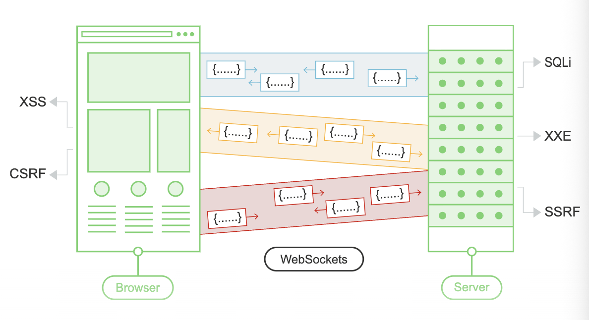

# WebSockets

WebSockets are widely used in modern web applications.

They're initiated over HTTP and provide long-lived connection with asynchronous communications in both directions.

WebSockets are used for all kinds of purposes, including preforming user actions and transmitting sensitive information.

Virtually any web security vulnerability that arises with regular HTTP can also arise in relation to webSockets communications.

Finding WebSockets security Vulnerabilities generally involves manipulating them in ways that the application doesn't expect.

    Burp Lets you
        1. Intercept and Modify WebSocket Messages
        2. Replay and generate new WebSocket messages
        3. Manipulate WebSocket Connections

## 1. Intercepting..

Browse to where you suspect the application is using a WebSocket.

You can determine that a websocket is being used by using the application and looking for entries appearing in the WebSockets history tab within burp proxy.

In the intercept tab of burp proxy,ensure that interception is turned on for websockets, when a websocket message is sent from the browser or server, it will be displayed in the intercept tab for you to view or modify.

> *You can configure whether client to server or server to client messages are intercepted in burp proxy. You can do this in the settings dialog, in the WebSocket interception rules settings.

## 2. Replaying..

You can replay individual message and generate new messages on *Repeater*.

    1. Select a websocket message from the proxy history and send it to repeater.
    2. From here you can edit the message end send it in either direction, client or server.
    3. You can view the history of messages that have been transmitted over the WebSocket connection via burp repeater via the History panel.

> *Note to self, I found the websocket history inside proxy.

## 3. Manipulating..